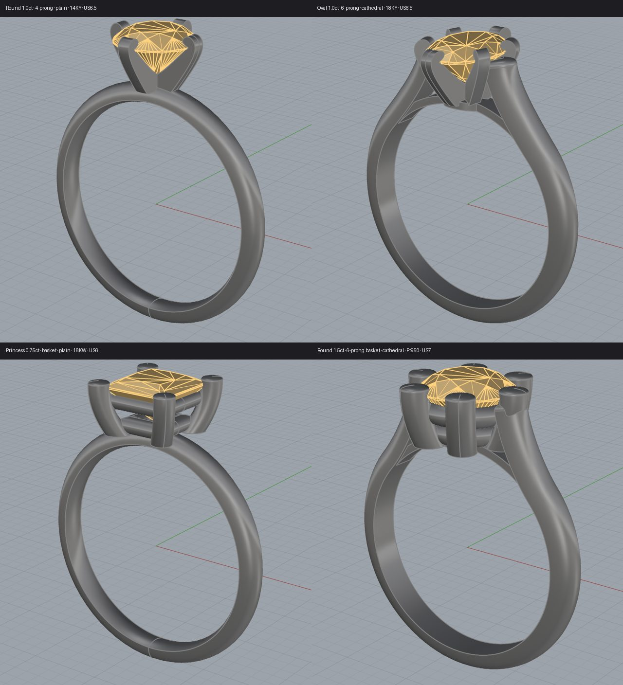
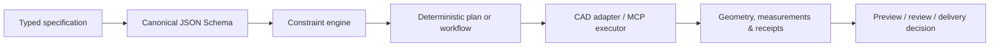

# MyJewl

### Structured specifications. Explicit constraints. Parametric jewelry geometry.

[](https://github.com/RotemAzriel/MyJewl-Showcase/actions/workflows/ci.yml)


MyJewl explores how to turn a typed ring specification into **validated, inspectable geometry**. Its engineering focus is the contract between the API, the design constraints, the CAD engine, and the evidence shown to the user.

This public showcase contains two independent components. They share a project lineage but have different schemas, feature sets, and test suites. They are kept separate so each remains reproducible.

**[Portfolio](https://rotem-azriel-portfolio.idan1623.chatgpt.site/) · [Architecture](docs/architecture.md) · [Validation](docs/validation.md) · [Publication notes](docs/publication-notes.md)**

## Choose a component

| Component | What it demonstrates | Start here |
|---|---|---|
| **Geometry service** | HTTP/JSON workflow, canonical schemas, constraint validation, evidence-backed preview resolution, measured metal weights, and explicit delivery/refusal states | [`geometry-service/README.md`](geometry-service/README.md) |
| **Artisan MVP** | The newer Aureon guided ring builder: deterministic build plans, a RhinoArtisan MCP client, geometry QA, and native CAD/export orchestration | [`artisan-mvp/README.md`](artisan-mvp/README.md) |

The geometry-service snapshot contains the mature foundation and local product workflow. The Artisan snapshot comes from the latest completed ring-type funnel checkout, dated **23 November 2026**, rather than the earlier guided-builder WIP checkout.

## The newer Artisan builder



Typed center-stone dimensions, ring size, setting style, shank, and alloy feed a deterministic planner. The executor resolves symbolic tool references, calls RhinoArtisan through local JSON-RPC, measures the result, and produces artifacts and a build manifest. The UI supports a guided choice of solitaire, hidden-halo, pavé-band, and halo styles within explicit compatibility limits.

The image shows existing project renders. Live CAD output is not regenerated as part of the public offline checks.

## The engineering contract



- **Validate before invoking CAD.** Reject invalid specifications at the boundary and keep flat-to-canonical conversion explicit.
- **Treat a plausible picture as insufficient evidence.** Differential and integrity checks compare what was requested with the geometry and receipt-backed assets actually produced.
- **Keep unsupported states visible.** Missing calibration, unavailable previews, paused perception, and undeclared delivery policy are named states.
- **Separate appearance from authority.** Browser materials and preview derivatives do not replace the CAD model or certify manufacturing suitability.

## Verify without Rhino or cloud accounts

```bash
git clone https://github.com/RotemAzriel/MyJewl-Showcase.git
cd MyJewl-Showcase
python3 -m venv .venv
source .venv/bin/activate
python -m pip install -r requirements-lock.txt
python tools/test_offline.py geometry-service
python tools/test_offline.py artisan-mvp
```

Use Python 3.13 for this public snapshot. Node.js 22 is needed for the geometry service's browser-script regression checks. The Python wrapper removes provider credentials and blocks external services and CAD endpoints while allowing local test servers.

**Rhino and a licensed RhinoArtisan installation are needed for actual Artisan builds.** The dry-run planner and fake-client regression tests work without them. The repository does not redistribute Rhino, RhinoArtisan, its license, or an MCP server implementation.

## Important limits

MyJewl **does not certify manufacturability**. Geometry gates such as `pending`, `not_run`, and `needs_calibration` are intentional. The older service's perception lane is paused by default; uploading a photo does not establish that its geometry has been inferred. Its geometry-delivery path also remains policy-gated. The Artisan builder has its own unsupported style/shape combinations and CAD-kernel limitations, documented with that component.

## Repository map

```text
geometry-service/       Established foundation, HTTP workflow, tests and contracts
artisan-mvp/           Latest ring-type builder, planner, MCP executor and tests
docs/                  Shared architecture, validation and publication scope
tools/                 Offline test wrapper
.github/workflows/     Independent CI checks for both components
```

Maintained by [Rotem Azriel](https://github.com/RotemAzriel). See [NOTICE.md](NOTICE.md) for source and third-party asset terms. Existing private repositories remain separate from this public showcase.
