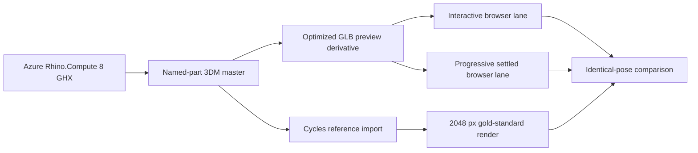

# Goal 0009 — reference-quality photoreal solitaire

## Decision

Goal 0009 is a single-product quality gate, not a catalog-expansion milestone.
The only accepted reference configuration is a US 6.5, 6.5 mm round,
four-prong **Classic Basket** head on a **Split Ring Solitaire** band in
polished 14k yellow-gold visual calibration. The reference retailer's
rose-gold image defines form and pose, not a copied catalog asset or a change
to the typed-metal contract.
Oval, pear, trilogy, pave, alternative heads, and cloud rendering are out of
scope until this gate passes explicit review.

The browser's current LatheGeometry shank, TorusGeometry gallery stack,
cylinder/sphere prongs, and concentric-ring gemstone are diagnostic preview
proxies. They must not be described as the Goal 0009 reference master.

## Authority and non-certification

`manual/tools/build_goal0009_preview_master_ghx.py` builds the stable-contract
definition that runs through Rhino.Compute 8 on the approved Azure Rhino Core.
Its named 3DM parts and OBJ/STL exports are derived preview assets; the GLB is
optimized from those Rhino-derived meshes locally. They do not replace the canonical
schema, do not establish production tolerances, and do not certify
manufacturability. All geometry gates remain `pending`, `not_run`, or
`needs_calibration`.

The operator explicitly approved Azure Rhino Core for this goal on 2026-07-29
and resumed the bounded goal on 2026-07-29 after rejecting the v1 visual.
The VM must be deallocated and verified after every bounded solve. RunPod and
other paid compute remain unauthorized.

## Bounded preview template

| Field | Reference value | Visual intent |
| --- | ---: | --- |
| Ring size | US 6.5 / 16.91 mm inner diameter | Fixed comparison scale |
| Shank | 2.05 mm wide / 1.65 mm radial thickness | Rounded comfort silhouette |
| Shoulders | 0.58 to 0.40 mm paired split sweeps | Visible split, graceful rejoin, no heavy cathedral pipes |
| Center stone | 6.50 × 3.90 mm round brilliant | Explicit 32-segment girdle and flat facet regions |
| Stone girdle Z | 12.10 mm | Fixed seating and camera comparison |
| Basket | 1.32 mm lower / 2.86 mm seat radii | Low open classic basket with four petal supports |
| Prongs | 0.34 mm root / 0.225 mm tip | Integrated curved taper with restrained rounded tips |
| Pavilion clearance | 0.58 mm visual target | Avoid shank/stone collision |

These values are design-review parameters only. They are not manufacturing
minimums or calibrated tolerances.

The first Azure-derived v1 render is retained only as rejected evidence. It
failed the visual gate because the rails read as stacked rings, the shoulders
read as heavy cathedral pipes instead of a distinct split band, the prongs
were too vertical, the 16-sided stone outline was coarse, the camera concealed
the split, and the high-key exposure clipped important form detail. V2 must
correct those specific defects before browser work begins.

## Required asset flow

The GLB must preserve meaningful part identity (`shank`, shoulders, basket
rails, petal supports, four prongs/tips, and `center_stone_round_brilliant`),
normals, metal/stone material separation, and deterministic geometry identity.
LODs may only be derivatives of this same bounded master.

## Visual acceptance gate

The quality gate requires all of the following:

1. Jeweler/design review of silhouette, shoulder flow, basket, prong form,
   seating, pavilion clearance, and visible component continuity.
2. A 2048 px Blender Cycles high-key product render using the master geometry.
3. Identical-pose browser evidence for interactive and settled lanes, plus a
   pre-rendered fallback for lower-capability/mobile devices.
4. Calibrated yellow/white/rose conductor presets and polished/matte/brushed
   microsurface behavior, while the accepted visual remains yellow/polished.
5. Desktop and mobile load, frame-rate, memory, fallback, and clean-console
   evidence.
6. Focused tests and the full unittest suite.

Failure to obtain explicit visual review keeps Goal 0009 active even if the
technical pipeline is complete.
